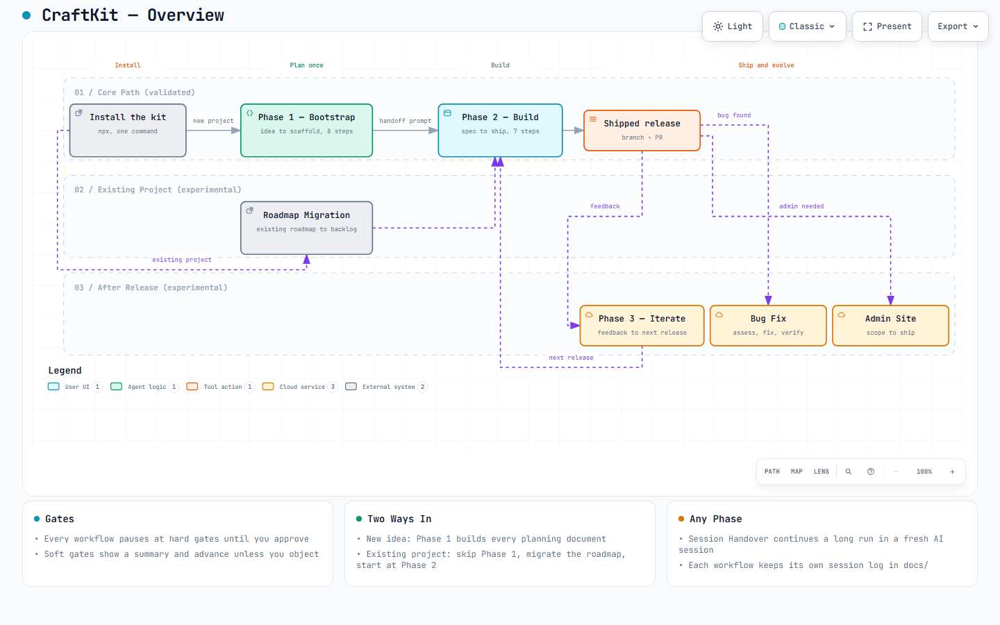
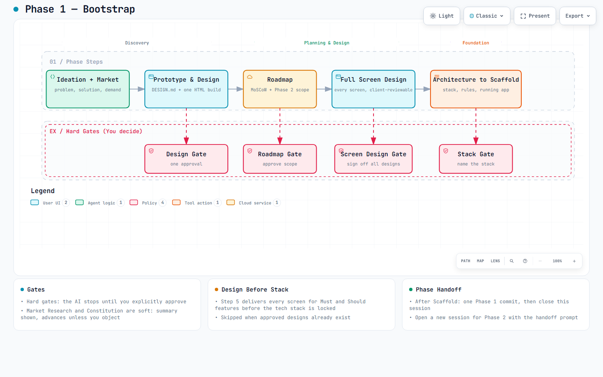
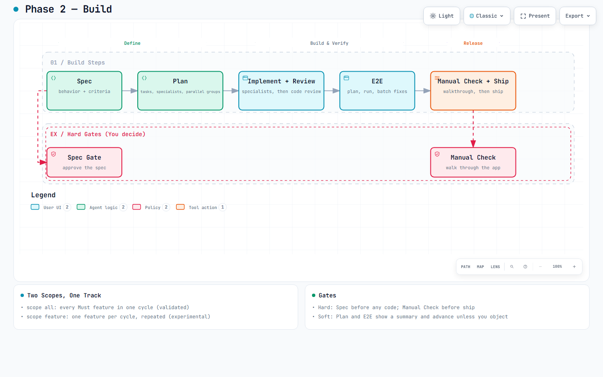

# CraftKit

> AI-agent workflow kit for building software products from idea to shipped features.

[](https://github.com/KhoaLy2003/craft-kit/actions/workflows/test.yml)
[](https://github.com/KhoaLy2003/craft-kit/actions/workflows/lint.yml)
[](https://github.com/KhoaLy2003/craft-kit/blob/main/LICENSE)
[](https://nodejs.org)

CraftKit is a structured workflow kit you share with your AI agent. Describe what you want to build — the agent handles research, design, planning, and implementation while pausing at key decisions so you stay in control.

Works with any AI coding assistant. Phase 1 maps your available models to three capability tiers once (`docs/MODELS.md`); every later step reuses that map.

**[Full documentation →](https://khoaly2003.github.io/craft-kit)**

---

## Table of Contents

- [How It Works](#how-it-works)
- [Quick Start](#quick-start)
- [Workflows](#workflows)
- [Required Skills & Agents](#required-skills--agents)
- [Kit Contents](#kit-contents)
- [Contributing](#contributing)

---

## How It Works

Phase 1 runs once and takes a raw idea to a working scaffold. Phase 2 builds the product — all Must features in one cycle, or one feature per cycle.

[](https://khoaly2003.github.io/craft-kit/diagrams/overview.html)

[](https://khoaly2003.github.io/craft-kit/diagrams/phase-1-bootstrap.html)

[](https://khoaly2003.github.io/craft-kit/diagrams/phase-2.html)

> [Interactive diagrams](https://khoaly2003.github.io/craft-kit/diagrams/) — pan, zoom, search, and export.

**Gates.** `none` advances automatically; `soft` shows a summary and advances unless you object; `hard` stops until you explicitly approve.

---

## Quick Start

**Requirements:** Node.js ≥ 18 and an AI coding tool. The skills and agents listed [below](#required-skills--agents) are optional add-ons that improve consistency; Phase 1 checks for them at the start.

```bash
# Install into ./kit
npx github:KhoaLy2003/craft-kit

# Update an existing install (also removes kit files dropped since the last install)
npx github:KhoaLy2003/craft-kit --force

# Kit files only, skip setup prompts
npx github:KhoaLy2003/craft-kit --skip-setup
```

Then:

```
1. Gather what you have: your own documents in any format (requirements, notes, research, tickets), or just your idea. No template is needed. The kickoff form at kit/templates/phase-1-kickoff.md is optional.
2. If your product has a screen, have a `docs/DESIGN.md` design-system file ready too (Step 3 needs one; sources and a custom-file skeleton are in `kit/steps/phase-1/p1-03-prototype-design.md`).
3. Open your AI session and say:
   "Start Phase 1 using kit/phase-1-bootstrap.md. My documents are at <paths>."  (or: "... Here is my idea: ...")

Step 1 lists every document you give it, says what it could not read, and asks only about gaps and conflicts.
Already have a codebase? Say: "Run Adopt using kit/phase-adopt.md."
Not sure where to start? Say: "Start using kit/START.md." It inspects the project and prints the workflow and the exact prompt to run.
```

**Browse your project documents in a browser** (read-only; needs Node ≥ 18, and network on the first run to install VitePress into `~/.craft-kit/viewer/`):

```bash
node kit/scripts/view-docs.js            # dev server, follows changes in docs/
node kit/scripts/view-docs.js --build    # static site (add --out <dir> and --base /path/)
```

It shows status badges, a backlog board, Mermaid diagrams, HTML prototypes, and lint findings. Credentials, dotfiles and JSON files in `docs/` are never served, and `docs/` itself is never modified.

---

### Lite kit (small personal projects)

A much lighter workflow for practice projects: three steps (Idea, Build, Wrap-up), one approval gate, about three documents.

```bash
npx github:KhoaLy2003/craft-kit --lite
```

Then open your AI tool in the project and say "I want to build ...". Run the installer from the project root: the kit goes directly under it (`./kit-lite`), and the wiring files live in the project root. The installer adds a workflow block to `CLAUDE.md` (and `AGENTS.md` if present) so the AI loads `kit-lite/START.md` by itself, and wires Claude Code hooks that record the conversation (your prompts and the AI's final replies, quoted) to `docs/audit/<date>-<session>.md`, git-ignored. If the audit stops recording, `docs/audit/.errors.log` says why. The hooks use Claude Code's exec form, so they work the same in bash, Git Bash and PowerShell. Opt out with `--no-hook` (no `CLAUDE.md` block; replies are then recorded without the AI's `[audit]` tag) or `--no-audit` (no hooks). If `.claude/settings.json` is not valid JSON, the hooks are skipped and the AI is not asked for tags. The audit works in Claude Code only. For production work use the full kit above.

## Workflows

Not sure where to start? Say `Start using kit/START.md.` The router inspects the project and prints the right workflow and prompt. Step-by-step pages for every workflow are in the [documentation](https://khoaly2003.github.io/craft-kit).

| Workflow | Entry file | Use when | Status |
|---|---|---|---|
| Phase 1 — Bootstrap (8 steps, once) | `phase-1-bootstrap.md` | New product: idea → researched, designed, architected scaffold in `docs/` | validated |
| Phase 2 — Build (7 steps) | `phase-2.md` | Build features: Spec → Plan → Implement → Review → E2E → Manual Check → Ship. Scope `all` builds every Must feature in one cycle; `feature` builds one per cycle | `all` validated, `feature` experimental |
| Adopt | `phase-adopt.md` | Existing codebase with no kit documents | experimental |
| Project Upgrade | `phase-upgrade.md` | Documents from an older kit; runs the one-time modules it detects | experimental |
| Maintenance (3 steps) | `phase-maintenance.md` | Add a feature (intake, fit check, backlog entry, then Phase 2) or fix a bug (routes to Bug Fix) | experimental |
| Bug Fix | `phase-bug-fix.md` | Something shipped is broken: Assess → Fix → Verify | experimental |
| Developer Onboarding | `phase-onboarding.md` | A developer is joining; writes `docs/ONBOARDING.html` | experimental |
| Session Handover | `guides/session-handover.md` | A long run continues in a fresh session | experimental |

Start Phase 2 with `"Run Phase 2 using kit/phase-2.md."` and Maintenance with `"Run Maintenance using kit/phase-maintenance.md."` It asks whether you want to add a feature or fix a bug, and registers a new feature before Phase 2 builds it.

---

## Required Skills & Agents

Optional add-ons. Phase 1 starts with a pre-flight that checks which are available; if any are missing the AI names the affected steps and continues with built-in behavior only after you agree. `npx github:KhoaLy2003/craft-kit` prompts you through setup interactively. Besides `kit/`, setup may write `.agents/skills/`, `.claude/skills/`, and `skills-lock.json`; skills are optional per-tool locations.

**Skills** — loaded via your platform's skill manager or plugin system:

| Skill | Used in |
|---|---|
| `brainstorming` | Phase 1 Step 1, Phase 2 Step 1 |
| `writing-plans` | Phase 2 Step 2 |
| `subagent-driven-development` | Phase 2 Step 3 |
| `dispatching-parallel-agents` | Phase 2 Step 3 |
| `using-git-worktrees` | Phase 2 Step 3 |
| `design-taste-frontend` | Phase 1 Step 3 (prototype), Phase 2 Step 3 (UI work) |
| `archify` | Phase 1 Step 6 (diagram render), Phase 2 Step 7 (re-render on request) |
| `requesting-code-review` | Phase 2 Step 4 |
| `code-review-and-quality` | Phase 2 Step 4 (five-axis review) |
| `security-and-hardening` | Phase 2 Step 4 (security axis) |
| `performance-optimization` | Phase 2 Step 4 (performance axis) |
| `code-simplification` | Phase 2 Step 4 (applying review fixes) |
| `finishing-a-development-branch` | Phase 2 Step 7 |
| `verification-before-completion` | All phases |

> Skills improve consistency, not possibility: without them your AI handles the same work from general capability.

All work uses your platform's general-purpose agent.

---

## Kit Contents

| Path | Purpose |
|---|---|
| `START.md` | Entry router: inspects the project and prints the workflow and prompt to run |
| `orchestrator-conventions.md` | Universal rules: step banner, PROJECT_ROOT, write verification, gates, Definition of Done, version record, docs lint |
| `phase-1-bootstrap.md` | Phase 1 orchestration, model tiers |
| `phase-2.md` | Phase 2 orchestration (scope `all` / `feature`) |
| `phase-maintenance.md`, `phase-bug-fix.md`, `phase-onboarding.md`, `phase-adopt.md` | Other workflows (experimental) |
| `guides/admin-checklist.md` | Admin site reference, loaded by Maintenance intake for admin features |
| `phase-upgrade.md`, `phase-docs-backfill.md`, `phase-api-backfill.md`, `phase-test-accounts-backfill.md`, `phase-verification-backfill.md`, `phase-log-collapse.md` | Project upgrade entry point and its one-time modules |
| `scripts/` | `render-backlog.js` (backlog validator and renderer), `lint-docs.js` (read-only lint of a project's `docs/`), `docs-index.js` + `view-docs.js` (docs viewer) |
| `viewer/` | VitePress config and theme used by `scripts/view-docs.js` |
| `session-logging.md` | Session log format |
| `stack-catalog.md` | Stack baseline and deviation model for the Architecture step |
| `task-agent-rubric.md` | Task type → specialist agent routing |
| `steps/phase-1/`, `steps/phase-2/` | Step detail files `p1-01` … `p1-08`, `p2-01` … `p2-07` |
| `templates/` | Output templates for Phase 1 artifacts, specs, E2E plan, model map, adopt survey, PR description, kit version record |
| `guides/` | `design-reference.md`, `session-handover.md` |
| `CHANGELOG.md` | Kit change history — kept in this repo, not installed |

---

## Contributing

Contributions welcome — new templates, alternative phase workflows (mobile, API-only), agent rubric entries, and fixes to gate logic or step outputs. Open a pull request describing what changes and why. See [open issues](https://github.com/KhoaLy2003/craft-kit/issues).

---

## License

MIT © [Khoa Ly](https://github.com/KhoaLy2003)
